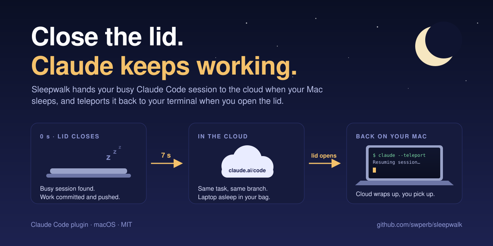

<div align="center">

# Sleepwalk

**Close the lid. Claude keeps working.**

[](#install)
[](#things-to-know)
[](LICENSE)



</div>

You give Claude Code a long job. It is halfway through. You have to leave, so you close
the lid, and the job stops with it.

Sleepwalk fixes that. It is Claude after you have gone to bed: eyes shut, arms out,
still committing. When you close your MacBook in the middle of a turn, Sleepwalk pushes
the work to a branch and hands the session to Claude Code on the web, which carries on
while the laptop sleeps in your bag. When you open the lid, it asks the cloud session to
wrap up and teleports it back into a terminal on your Mac.

No new habits. You do not start anything in the cloud up front, and you do not have to
remember a command. You close the lid.

## The numbers

Measured on a MacBook Pro on home Wi-Fi, in two full real round trips (lid closed, work
in the cloud, lid opened, session teleported back):

| What | Measured |
|---|---|
| Lid closed to cloud session running with your brief | **5 s** and **7 s** |
| Committing and pushing the work in progress | 0 to 2 s |
| How long Sleepwalk holds off sleep | 7.9 s at most (from the macOS power log) |
| Lid opened to cloud session told to wrap up | 5 s |
| Test suite | 112 checks in about 40 s, no network or launchd needed |

## Why this does not exist already

Claude Code can pull a cloud session *down* into your terminal with `claude --teleport`.
It cannot push a session that is already running on your laptop *up*. The usual advice
is to start long tasks in the cloud from the beginning. Sleepwalk does the push for you,
at the one moment you actually decide to stop: when the lid closes.

## Install

You need macOS with the Xcode command line tools (`xcode-select --install`), `jq`, and
Claude Code signed in with a claude.ai account that can use
[Claude Code on the web](https://code.claude.com/docs/en/claude-code-on-the-web). Your
repositories need a GitHub `origin` that the Claude GitHub app can read.

In Claude Code:

```
/plugin marketplace add swperb/sleepwalk
/plugin install sleepwalk@sleepwalk
/sleepwalk:install
```

Then work as usual. When the watcher first starts, macOS asks once whether it may read
the folder your projects are in (usually Documents). Allow it.

## How it works

**While you work.** The plugin's hooks keep a small record for each Claude Code session:
its folder, its transcript, and whether it is *busy* (a turn is running) or *idle*.

**When you close the lid.** A small LaunchAgent, `sleepwatch`, gets macOS's "will sleep"
notice and holds sleep off for a few seconds. For each busy session, one per working tree:

1. If the checkout is on the default branch, the work moves to a new
   `sleepwalk/<time>-<session>` branch, so work in progress never lands on `main`.
2. Everything uncommitted is committed as `WIP: hand off to cloud while the laptop
   sleeps` and pushed. Two things stay behind on the laptop, untouched: nested git
   repositories (such as Claude Code's agent worktrees in `.claude/worktrees/`, or other
   clones inside the checkout) and files over `MAX_FILE_MB`. The commit message, the log
   and the cloud session's brief list what was left out. Real submodules are committed
   as usual.
3. A cloud session starts and receives a brief: your original request and the latest
   part of the conversation, with instructions to carry on, push small steps, and stop
   when you are back.
4. The local session is paused. Its tool calls and prompts are refused with a note saying
   where the work went, so two agents never edit the same tree.

**If anything fails** (no network, push rejected, cloud session not confirmed),
Sleepwalk puts everything back: the WIP commit is undone with your changes kept, the
original branch is checked out again, and the pushed branch is removed. The session is not
paused, and you get a notification when the Mac wakes.

**When you open the lid.** Sleepwalk waits for the network, tells each cloud session to
commit, push and stop, and opens one Terminal window per session, titled after its
repository, in the order they were handed off, and brings Terminal to the front. Each window shows the branch, the cloud
link, the commits the cloud session made while you were away, and one status line. It
watches the cloud branch on GitHub and runs `claude --teleport` as soon as the cloud
session has pushed and gone quiet for 8 seconds, or after 45 seconds at most (press
Enter to go now). Teleport checks out the cloud branch and loads the whole cloud
conversation.

If the lid opens with no network, Sleepwalk keeps waiting, says so in a notification,
and brings the sessions back as soon as the Mac is online. If `claude --teleport` fails,
the window says how to retry (`sleepwalk resume`), open the session on the web, or keep
the local copy (`sleepwalk release`), and the session stays paused for the next wake.

## Folder trust

Claude Code asks "do you trust this folder?" the first time it works in a folder. For
interactive sessions, trusting `~/Projects` also covers `~/Projects/my-app`. Creating a
cloud session checks the folder itself, so a project trusted only through a parent would
be asked again at the moment Sleepwalk hands it off.

Sleepwalk never answers that question for you. At the start of a session in such a
project, it asks Claude to check with you, once per project, and records trust with
`sleepwalk trust <folder>` only if you agree. If you decline, a handoff from that project
fails at once, is rolled back, and the log tells you what to run.

## Driving with your laptop in the bag

The laptop needs no connection while it sleeps: the cloud session runs on Anthropic's
servers either way. It needs one for a few seconds when the lid closes, and again when
it opens.

Your iPhone is a saved network through iCloud, so macOS can join its Personal Hotspot
without a password. Set System Settings > Wi-Fi > **Ask to join hotspots** to
**Automatic**. As a backup, Sleepwalk can join it itself when it finds no network:

```bash
sleepwalk hotspot                     # lists the iPhone hotspots macOS has saved
sleepwalk hotspot "Alex's iPhone"     # picks one; a plain ' matches the ’ in the name
```

This backup uses `networksetup` and is covered by tests, but not yet proven in a car.
Whether it can wake a hotspot that is not broadcasting yet, the way the Wi-Fi menu does,
is not verified, so keep the macOS setting on.

## Commands

In Claude Code: `/sleepwalk:status`, `/sleepwalk:resume`, `/sleepwalk:install`. In a
terminal, `~/.claude/sleepwalk/bin/sleepwalk`:

| Command | What it does |
|---|---|
| `status` | Tracked sessions, their state and handoffs, and whether the watcher runs |
| `resume <session>` | Brings a handed-off session back by hand |
| `release <session>` | Drops a handoff and unpauses the local copy |
| `prune` | Forgets old session records and leftover files now (it also runs hourly) |
| `trust <folder>` | Records Claude Code trust for exactly this folder |
| `hotspot [name]` | Lists saved iPhone hotspots, or picks one to join when offline |
| `sleep --dry-run` | Shows what a sleep would do, and writes the brief, without doing it |

## Settings

`~/.claude/sleepwalk/config`, in shell syntax:

| Setting | Default | Meaning |
|---|---|---|
| `TRIGGER` | `lid` | `lid` hands off only when the lid closes; `any` on every sleep |
| `SCOPE` | `busy` | `busy` hands off sessions mid-turn; `recent` also ones used in the last `RECENT_MINUTES` |
| `STALE_MINUTES` | `20` | A busy session with no sign of life for this long counts as idle. Raise it for very long builds |
| `INCLUDE_UNTRACKED` | `1` | Commit untracked, non-ignored files too |
| `MAX_FILE_MB` | `50` | Leave files bigger than this out of the WIP commit, so the push is not refused (GitHub's limit is 100 MB). `0` for no limit |
| `AUTO_RESUME` | `1` | Open a Terminal on wake; `0` shows a notification instead |
| `WRAPUP_WAIT` | `45` | Most seconds the cloud session gets to push before teleporting |
| `PUSH_QUIET` | `8` | Teleport once the cloud branch has moved and then stayed still this long |
| `TERMINAL_APP` | `Terminal` | For example `iTerm` |
| `HOTSPOT_SSID` | (none) | Network to join when offline; set it with `sleepwalk hotspot` |
| `SLEEP_BUDGET` | `22` | Seconds the lid-close step may take (macOS forces sleep at about 30) |
| `RESUMED_KEEP_HOURS` | `24` | How long to keep a session's record after it was teleported back |
| `PRUNE_DAYS` | `7` | Forget sessions, and handoffs never resumed, after this many days without activity |
| `LOG_MAX_KB` | `1024` | Past this size `handoff.log` and `sleepwatch.log` move to `<log>.1` and start afresh |

## Things to know

- **macOS only.** It relies on macOS power notifications and launchd.
- **Untracked files are pushed.** Anything not in `.gitignore` goes into the WIP commit
  and to GitHub. Keep secrets ignored.
- **The cloud agent gets a brief, not your conversation.** There is no way to move a local
  transcript into a cloud session, so it sees your original request, the recent messages
  and the repository. Coming back is complete: `--teleport` loads the whole cloud
  conversation.
- **Processes the session started keep running.** Sleepwalk pauses the session's tool
  calls, but a build or script it had already started carries on when the Mac wakes. If
  it changes files, `--teleport` offers to stash them.
- **Old records clean themselves up.** At most once an hour, at session start and on wake,
  Sleepwalk forgets sessions teleported back over a day ago, sessions and handoffs idle for
  a week, resume `.command` files nobody ran, and leftovers from killed processes. The
  old copy of a session teleported back is unpaused when its record goes.
- **A closed lid with an external display** does not sleep, so nothing is handed off.
- **Not an Anthropic product.** Sleepwalk is an independent open-source plugin that uses
  Claude Code's public CLI.

## FAQ

**Does my laptop stay awake in the bag?** No. It sleeps as normal. Sleepwalk only delays
sleep by a few seconds while it hands off.

**Will it hand off a session that is just sitting there?** No, only sessions in the middle
of a turn, unless you set `SCOPE=recent`.

**What if I open the lid ten seconds later?** You get a short round trip. Your work is
already on the branch, the cloud session is told to push what it has, and the teleport
brings its conversation back.

**What does it cost?** Sleepwalk is free and MIT-licensed. The cloud sessions it starts
are ordinary Claude Code on the web sessions, with whatever usage and limits your plan
gives those.

## Testing

```bash
tests/test.sh
```

The tests drive install, the hooks, sleep, rollback, folder trust, the hotspot, release,
resume and uninstall against a temporary home, local bare remotes and fake `claude` and
`networksetup` commands. Real lid-close round trips were checked by hand.

## License

MIT
